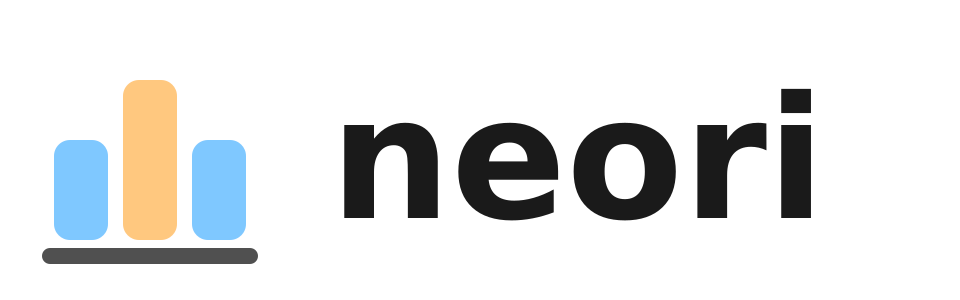
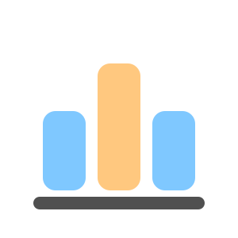
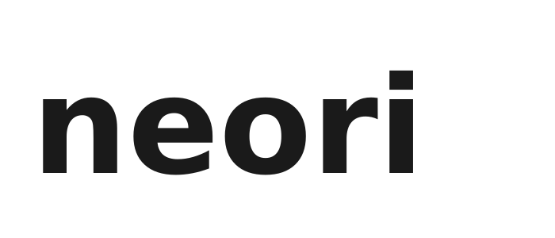
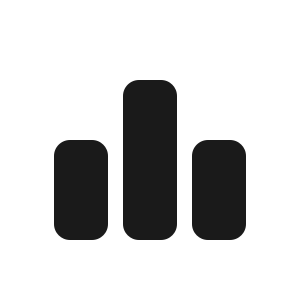

The name "neori" is canonically written in lower-case, but feel free to capitalize it if you'd like, especially at the start of sentences where the grammatical rules require it.
This name is not intended to mean or stand for anything.

Our logo comes in four versions: full-sized, simple full-sized, icon, and simple icon.
The simple versions are single-color and suitable for smaller sizes.

|        | full-sized                     | icon                           |
|--------|:------------------------------:|:------------------------------:|
| normal |       |       |
| simple |  |  |

The logo is intentionally recolorable: the full-sized logo uses two accent colors over a muted baseline, while the simple versions are single-color and suitable for small sizes.
The mark shows three rounded columns of differing heights resting on a horizontal strip, evoking neori's scrollable-tiling layout.

All versions of the logo are licensed under [CC BY-SA](https://creativecommons.org/licenses/by-sa/4.0/).
